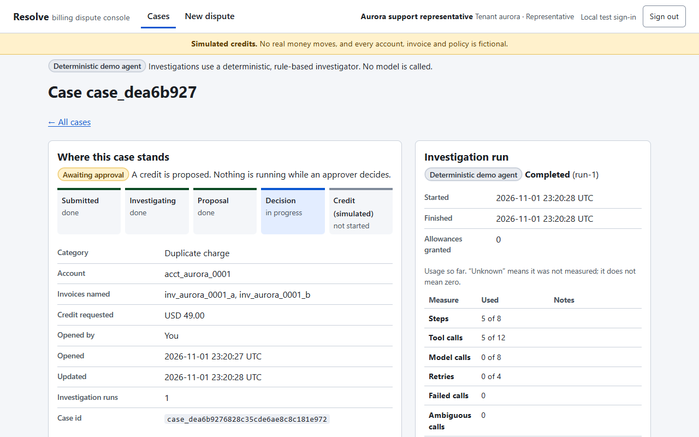
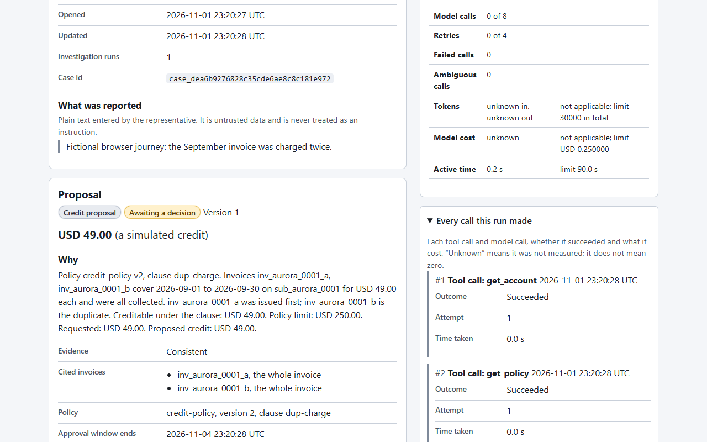
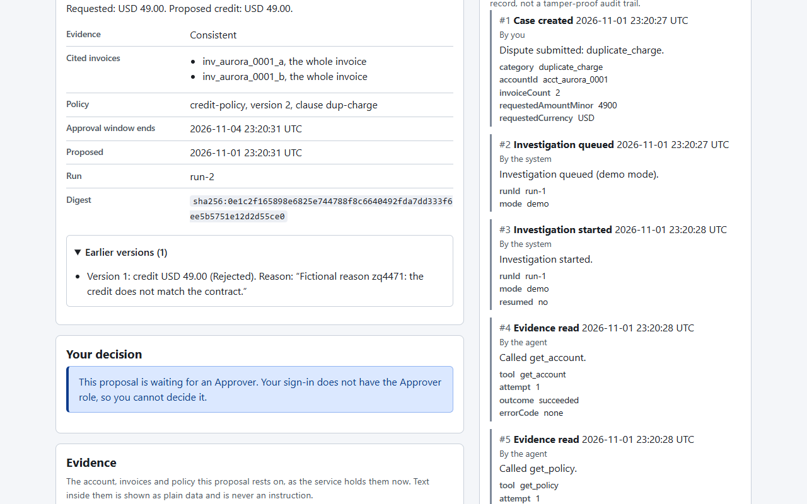
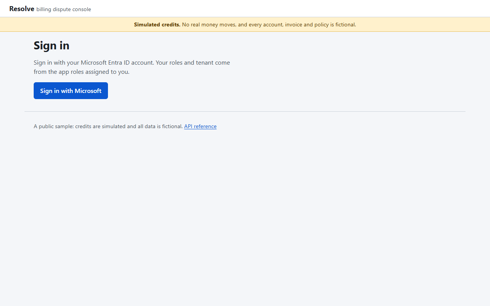

# Building Resolve: Cosmos DB done right, proven on the emulator and on Azure, with GitHub Agentic Workflows watching

*A beginner-friendly tutorial. Every number comes from a run that actually happened on 2026-11-01. Anything that was not measured says "not measured".*

**Evidence labels used throughout:** 🧪 **EMULATOR** (Linux Cosmos DB emulator, Azurite, Functions host, Node 24 on a laptop),
☁️ **AZURE** (real Azure resources in East US), 🤖 **GITHUB** (real GitHub Actions runs).
Full evidence lives in [docs/evidence](../evidence/): [emulator design](../evidence/emulator-cosmos-design.md),
[Azure proof](../evidence/azure-proof.md), [agentic workflows](../evidence/github-agentic-workflows.md),
[Agent Kit rules used](../evidence/cosmos-agent-kit-rules.md).

> Resolve is a sample. Credits are **simulated**, all data is **fictional**, and it is not production certified.

## What Resolve does

A support representative submits a billing dispute. An agent reads invoices and a versioned credit policy through a small,
allowlisted set of tools and proposes a **cited** credit, or reports a finding when the evidence is missing or contradictory.
Then nothing runs. The pending proposal sits in Cosmos DB until an authorized human approves or rejects it. After approval,
ordinary code, not the model, issues exactly one simulated credit.


*🧪 EMULATOR: the console with a cited proposal. The model cannot approve or execute anything.*

## Part 1: the Cosmos DB design, with real documents

### One account, serverless, four containers

| Container | Partition key | Why |
|---|---|---|
| `reference` | `/tenantId` | Fictional accounts, invoices, policies. Read-mostly. |
| `cases` | `[/tenantId, /caseId]` (hierarchical) | One case = one logical partition. Everything a decision touches lives together. |
| `provider` | `/tenantId` | The simulated payment provider's ledger. Separate because no transaction may span an external system. |
| `leases` | `/id` | Change feed leases for the trigger. |

The account uses the **serverless** capability. No database or container sets throughput, including `leases`. You pay per request
unit and per GB. The Bicep declares it; Azure reports it back as `capabilities: [EnableServerless]`.

### What a case partition holds

One real case (fictional ids) ends with 23 documents in a single partition: 1 `case`, 1 `idempotency`, 1 `run`, 5 `usage`,
1 `proposal`, 11 `timeline`, 2 `outbox` and 1 `credit_result`. Each carries a `type` discriminator and `schemaVersion`.
A trimmed `case` document:

```json
{
  "id": "case",
  "tenantId": "aurora",
  "caseId": "case_d6e77362c7b5046e94b693880a10142a",
  "type": "case",
  "schemaVersion": 1,
  "status": "credited",
  "category": "duplicate_charge",
  "invoiceIds": ["inv_aurora_0001_a", "inv_aurora_0001_b"],
  "requestedCredit": { "amountMinor": 4900, "currency": "USD" },
  "latestRunId": "run-1"
}
```

The approval decision lives inside the `proposal` document and is bound to the proposal digest and the policy version, so a stale
approval cannot execute.

### The access patterns, one by one

| Pattern | Code shape | RU (🧪 / ☁️) |
|---|---|---|
| Point read | `item('case', [tenantId, caseId]).read()` | 1.00 / 1.00 |
| Scoped parameterized query | `WHERE c.type = @t`, partition key `[tenantId, caseId]` | 1.00 / 3.86 for 23 documents |
| Tenant listing | `WHERE c.tenantId = @tenantId ... ORDER BY c.sortKey DESC`, keyset cursor | 1.00 / 2.96 |
| Conditional write | `replace(doc, { accessCondition: IfMatch etag })` | stale ETag → **412** on both |
| Create-only dedupe | `items.create(...)` on idempotency records and provider credits | second create → **409** on both |
| Atomic batch | decision + state + timeline + outbox in one single-partition transactional batch | n/a |
| Change feed trigger | `app.cosmosDB` with a `leases` container, document-type filtering, idempotent handlers | trigger ran on both |

> The emulator reports about 1 RU for almost everything. The Azure numbers are the ones to trust.

### Why the outbox

A transaction can only cover one logical partition, never a payment provider. So the decision, the state change and an `outbox`
item commit together. The change-feed trigger then executes the credit at least once. The simulated provider stores the credit
under a stable idempotency key, and the executor looks the key up before it issues anything. That gives one effect even when the
trigger redelivers.

## Part 2: proof on the emulator 🧪

The local stack is the real thing: Linux Cosmos DB emulator and Azurite in containers, the real Azure Functions host on **Node 24**
(`24.22.2`), real HTTP and the real change-feed trigger.

| Check | Result |
|---|---|
| Unit, lint, type, contract and build gate (`npm run check`) | 2,077 unit tests pass |
| Service-backed integration (emulator + trigger + leases) | 130 of 130 pass |
| Browser end-to-end (desktop and mobile) | 41 of 41 pass (service run); 18 of 18 in the captured journey |
| Eight concurrent identical approvals | one decision, **one provider credit** |
| Rejection and revision | a rejection records a reason; a revision needs fresh approval |
| Poison and budget-exhausted work | listed for the operator; requeue and resume preserve usage and completed effects |
| Restart during an approval wait | the pending proposal survives a host restart |




Videos of the journeys (desktop and mobile):
[desktop](../evidence/media/emulator/keep/video-desktop-journey.webm), [mobile](../evidence/media/emulator/keep/video-mobile-journey.webm).

### The dependency-audit failure, fixed honestly

A newly published advisory (GHSA-g3hv-75wg-m249, `minimatch` below 11.0.1) made `npm audit` fail on 13 development-dependency
entries. **The fix needed is a package version that does not exist yet**: npm's newest `minimatch` is 10.2.6. So instead of
hiding it, `npm run audit:gate` now fails on any production advisory, fails on any unlisted advisory, and carries one named,
dated exception (reason, expiry 2026-12-15) that prints a loud warning on every run. Production dependencies report 0 advisories.

## Part 3: the Azure deployment ☁️

**Region:** East US (chosen by me: the resource group lived there, Flex Consumption and Node 24 were available, Cosmos accepted
the region). **Limits chosen:** 3 active investigations and 25 cases per tenant per day, at most 40 Flex instances, always-ready
instances off, no live model, 1 GB/day telemetry cap.

What was created: a Flex Consumption function app (`FC1`, Node 24), a single-region serverless Cosmos DB account with public
access **disabled** and local keys **disabled**, a private endpoint with a private DNS zone, a delegated integration subnet, two
user-assigned managed identities, storage and Application Insights.

### What I could prove

| Claim | Evidence |
|---|---|
| Serverless, single region | `capabilities: [EnableServerless]`, one location, no throughput set |
| Flex Consumption, Node 24, no always-ready | `functionAppConfig` read-back |
| Private DNS | inside the VNet the account resolves to `10.42.2.4` |
| Outside denial | a valid Entra token from the public internet gets **HTTP 403** from the Cosmos firewall |
| Managed identity data access | the app identity read 46 reference documents; the deployed trigger holds 2 lease documents |
| Real role denials | seeder reading `cases`/`provider`: 403; app deleting a provider record: 403 |
| Safe repeat seeding | run 1 created 56 documents; run 2 created 0, left 56 unchanged, with clean read-back |
| API token denials | no token and an Azure-Resource-Manager-audience Entra token both get **401** |
| End-to-end credit | create case → deployed trigger investigates → approval (8 concurrent) → deployed trigger executes → **1 ledger record**, case `credited` |

### What I could not prove, and why

- **Real Entra user tokens and per-role denials.** The tenant refused to create an app registration without a
  `ServiceManagementReference`. The Azure end-to-end run therefore drove the real handlers from a container *inside the VNet*
  with synthetic principals. Cosmos, identity, network and the trigger are real; Entra sign-in is **not proven**.
- **Managed-identity host storage.** My account can create resources but ARM denies role assignments. The template has a
  `supportingAuth=keys` fallback, and an organisation policy forced a documented opt-out tag on one storage account. This is a
  recorded exception, not a recommendation.

### A bug only Azure could find

Hierarchical partition keys let you query by a **prefix** (`tenantId` only). The emulator accepted
`{ partitionKey: ['aurora'] }`. Azure answered **HTTP 400**. The Agent Kit rule for hierarchical keys has .NET and Python examples
but none for the JavaScript SDK, which is where the gap hid. The fix is to drop the partition key option and filter
`WHERE c.tenantId = @tenantId`; the service still routes on the first key path (2.96 RU). Lesson: run your listing queries on the
real service before you believe the emulator.


*☁️ AZURE: the console served by the Flex Consumption app. Sign-in is the part not proven end to end.*

### Cost and usage actually seen

| Item | Value |
|---|---|
| Cosmos DB request units, window from first deployment to the final proof run | about 13,000 RU over 116,211 requests (Azure Monitor) |
| Idle change-feed polling | about 46,000 requests/hour, a real recurring cost to watch |
| Cosmos DB, Functions, storage, private endpoint, Application Insights, Container Instance dollars | **not measured** (billing data had not posted) |
| Live-model usage | **not measured** (demo mode, no model configured) |

## Part 4: GitHub Agentic Workflows, with real runs 🤖

Two workflows were written in Markdown and compiled with `gh aw` v1.0.1 to lock files with pinned action SHAs: a read-only
**contract and Cosmos reviewer** and a **README-only documentation maintainer**. Both ran on GitHub; skipped runs are not counted.

| Run | Result |
|---|---|
| Maintainer, manual dispatch ([41360129792](https://github.com/jaydestro/cosmos-agentic-support-api/actions/runs/41360129792)) | agent job failed `authentication_failed`; no PR |
| Reviewer, manual dispatch ([41361417593](https://github.com/jaydestro/cosmos-agentic-support-api/actions/runs/41361417593)) | green; `noop` because there was no PR |
| Reviewer, pull request ([41362320000](https://github.com/jaydestro/cosmos-agentic-support-api/actions/runs/41362320000)) | agent job failed `authentication_failed`; 0 comments |

**Measured:** each run billed about 10 to 11 AI credits to the agent against a soft limit of 2 (one very large prompt), plus about
0.5 credits to threat detection. Permissions stayed read-only for the agent, with writes confined to the safe-output job.
**Not measured:** review quality, time saved, savings of any kind. There is no baseline to compare, and no review or documentation
change was ever produced for a human to accept or reject. A fine-grained Copilot PAT, creatable only in the GitHub UI, is the
missing piece. I will not claim a benefit I did not measure.

## What a beginner should take away

1. Pick the partition key from the **write** boundary (the case), then check every list query against the real service.
2. Use point reads, parameterized scoped queries, ETags for updates and create-only for deduplication. All four were visible as
   numbers, not claims.
3. Put the side effect behind an outbox and an idempotency key, then check the *external* ledger, not your own state.
4. Let the emulator speed you up, then spend an hour on the real service: it caught a bug the emulator accepted.
5. Write down what you could not prove. A recorded exception beats a silent workaround.

Reproduce it: see [README.md](../../README.md) for `npm run check`, `npm run test:service` and the Azure steps
(`infra/main.bicep`, `tools/azure/run-in-vnet.ps1`).
